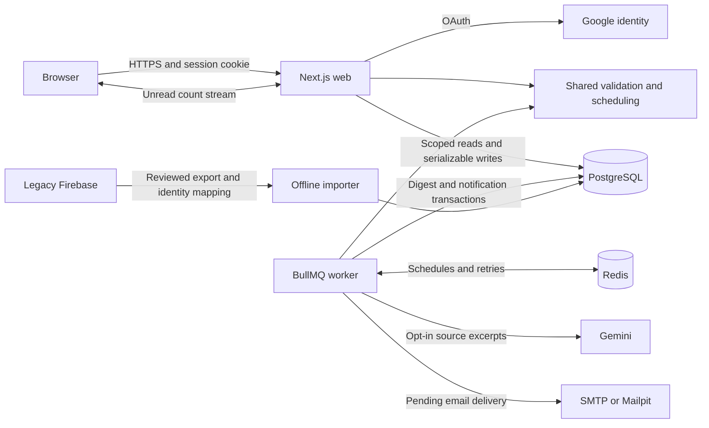

# Architecture and security decisions

## Authentication and roles

Auth.js manages signed and encrypted JWT sessions. Production uses Google OAuth and admits verified Google email addresses. Password accounts are available in development with explicit configuration and use salted scrypt digests. The production public URL must use HTTPS. Configure ingress to overwrite forwarded host and protocol headers.

Every protected operation resolves the current membership from PostgreSQL. Members can publish their own check-ins, create and discuss blockers, and manage their own assigned work. Admins and owners can invite people and update workspace settings. The owner controls membership roles and removals. A removed account loses workspace access immediately, while attributed historical content stays available to the team. Incoming invitation tokens are tied to an intended email, expire after 72 hours and are stored only as SHA-256 hashes. Invitation links are shown to the inviter for delivery through a trusted channel.

## Tenant isolation and concurrency

Protected lookups combine the active membership and workspace ID with any resource ID. Composite foreign keys prevent linking a workspace record to an update, actor, assignee, or commitment in another workspace. PostgreSQL does not use a row-level policy here. Keep database credentials restricted to the web and worker service accounts, and use the scoped data-access functions for new routes.

Commands use serializable transactions with bounded serialization retries. Standups, drafts, blockers, and commitments check client versions. A standup and its audit entry commit together, as do assignments and their notifications. The database enforces one standup per member per local date. Blocker deduplication normalizes title whitespace, case, and Unicode within the workspace. Review a recurring issue and explicitly reopen the existing item if appropriate.

The mutation endpoint uses a bounded JSON body, validates it with shared Zod contracts, and compares the Origin header with the application’s configured origin. Sensitive commands use database-backed rate limits. Expected errors expose a message and request ID. Unexpected errors log only the error class and return a generic message. React renders updates as text and restricts external task links to HTTP(S).

## Scheduling and side effects

The BullMQ planner evaluates the workspace’s IANA time zone every minute. Date-based job IDs and database uniqueness protect logical daily work from duplicate execution, including fall-back transitions. During spring-forward a skipped time runs at the next observed eligible minute. The weekly digest is scheduled on the last configured weekday of the Sunday–Saturday calendar week and covers the seven calendar days ending on that day.

Every in-app notification has a unique workspace, recipient and event key. The same record tracks optional email delivery. The worker checks membership and opt-in again before delivery, claims work with a lease, and gives each message a stable SMTP Message-ID. A crash after SMTP acceptance can still result in a repeat. Monitor pending, failed and stale email claims.

SSE sends only the current recipient’s unread count. The short-lived stream rechecks active membership on each poll and reconnects in the browser. Mutable workspace data reloads after successful commands.

## AI and observability

Gemini is configured on the worker and requires a workspace opt-in. It sees at most 30 updates with bounded excerpts and source IDs. Instructions tell the provider to treat update contents as untrusted data. The response is validated with Zod and available source IDs. The browser displays advisory text with links. Workspace mutations always go through explicit user commands.

An unavailable or disabled provider leaves deterministic digests available. JSON logs record request IDs, command types, job IDs, retry attempts, and model token usage. Web commands and worker jobs expose spans through the OpenTelemetry API. The dependency lock overrides the Prisma CLI’s merge library and Auth.js’s optional Nodemailer peer to use patched releases. Auth.js does not use its email provider in NoMeet. Register a Node OpenTelemetry provider or auto-instrumentation agent in each process to export those spans. Keep log access restricted and exclude invite URLs, tokens, OAuth data, and user content from upstream request logs.
